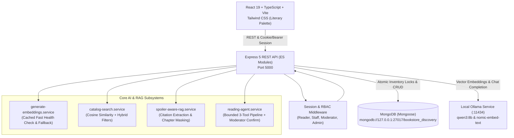

# The Independent Shelf — Independent Bookstore Discovery & Clubs

[-green.svg)](https://nodejs.org/)
[](https://react.dev/)
[](https://tailwindcss.com/)
[](https://www.mongodb.com/)
[-black.svg)](https://ollama.com/)

> **A full-stack, AI-powered web application that helps readers discover books from independent bookstores based on remembered themes, moods, and plot fragments—even when they do not know a book's title or author.** Readers can verify live local stock, place atomic hold reservations, track personal reading progress, and participate in community reading clubs featuring **chapter-synchronized anti-spoiler shields** and **bounded multi-tool AI book selection agents**.

---

## 🏛️ System Architecture



---

## ✨ Key Features & Architectural Guarantees

### 1. 🔍 Thematic & Mood Semantic Discovery
- **Natural Language Matching:** Allows readers to query with queries like *"atmospheric locked-room mysteries set in snowy manors"* or *"gentle cozy fantasy about found families and running a tea shop"*.
- **Local Vector Cosine Similarity:** Embeddings generated via local Ollama `nomic-embed-text:latest` (with high-performance fallback caching).
- **Match Reasons & Missing Criteria:** Explains to the reader *why* a book was recommended, its similarity score, and flags any requested constraints that were missing.

### 2. 🛡️ Spoiler-Aware RAG with Dynamic Chapter Masking
- **Strict Citation Grounding:** LLM responses are grounded in verified book chapters and catalog documentation without hallucinated details.
- **Progress-Limited Boundary:** Readers set their current reading position (e.g. Chapter 4). The RAG pipeline automatically filters out chunks beyond that chapter and masks plot developments with visual warning shields.
- **Club Discussion Masking:** Posts tagged with spoilers are blurred with a 1-click reveal button for readers who haven't reached that chapter yet.

### 3. 🔒 Atomic Concurrency-Controlled Inventory Reservations
- **Zero Overselling:** Uses conditional atomic updates (`$inc: { quantityReserved: +qty, availableQuantity: -qty }` where `availableQuantity >= qty`) ensuring race conditions cannot cause double-booking.
- **Free 48-Hour Pickup Holds:** No prepayment required; held behind the bookstore register with automatic release if cancelled or expired.
- **Scheduled Expiry Background Worker:** Checks every 60 seconds and auto-releases expired holds.

### 4. 🤖 Bounded 3-Tool AI Agent Workflow
Club moderators can trigger an autonomous agent that executes a strictly bounded 3-tool pipeline:
1. `searchCatalogTool`: Finds candidate books based on thematic guidance.
2. `checkStockAndLengthTool`: Validates real-time shelf copies across independent bookstores and page length limits.
3. `compareClubConstraintsTool`: Evaluates candidate suitability against club group size and meeting pace.
- **Human-in-the-Loop Confirmation:** The agent never auto-selects books without explicit moderator review and confirmation.

---

## 👥 Pre-Seeded Evaluator Personas

The application includes pre-seeded demo accounts accessible via **One-Click Persona Login buttons** on the Login page and Homepage:

| Role | Email | Password | Primary Capabilities |
| :--- | :--- | :--- | :--- |
| **Verified Reader** | `reader@indiebooks.demo` | `ReaderPass123!` | Thematic search, bookstore hold reservations, reading lists, progress tracking, spoiler-safe RAG chat. |
| **Unverified Reader** | `unverified@indiebooks.demo` | `ReaderPass123!` | Test email verification enforcement on protected reservation routes. |
| **Indie Bookseller** | `bookseller@beaconhill.demo` | `BooksellerPass123!` | Beacon Hill Books staff dashboard: live shelf stock adjustment with audit logs, customer hold collection, store policy editor, document ingestion. |
| **Club Moderator** | `moderator@bookclub.demo` | `ModeratorPass123!` | Coastal Mystery Society moderator: schedule meetings, moderate spoiler posts, run 3-tool AI book selection agent. |
| **System Admin** | `admin@indiebooks.demo` | `AdminPass123!` | System health monitor, 15 AI evaluation query suite, staff role assigner, full audit log stream. |

---

## 🚀 Quickstart & Installation

### Prerequisites
- **Node.js**: v20 or higher (v24 recommended)
- **MongoDB**: Running locally on `127.0.0.1:27017`
- **Ollama**: Running locally on `127.0.0.1:11434` with models:
  ```bash
  ollama pull qwen3:8b
  ollama pull nomic-embed-text
  ```

### 1. Backend Setup & Database Seeding
```bash
# Navigate to server directory
cd server

# Install dependencies
npm install

# Seed the database (4 bookstores, 32 books with vectors, 156 inventory items, demo users, clubs, chunks)
npm run seed

# Run automated test suites (Auth, Inventory Concurrency, Spoiler RAG, Club Agent)
npm test

# Start the Express backend server (Port 5000)
npm start
```

### 2. Frontend Client Setup
```bash
# Navigate to client directory in a separate terminal
cd client

# Install dependencies
npm install

# Build production bundle (verifies TypeScript & styles)
npm run build

# Start the Vite development server (Port 5173)
npm run dev
```

Open your browser at **`http://localhost:5173`**.

---

## 🧪 Automated Test Suite

Run the full end-to-end unit and integration test suite:
```bash
cd server
npm test
```

### Test Coverage Highlights:
1. **`auth.test.js`**: Registration, login, verification token simulation, session validation, RBAC rejection.
2. **`inventory-concurrency.test.js`**: Concurrent reservation race conditions, conditional atomic decrements, stock restoration on cancellation.
3. **`spoiler-rag.test.js`**: Progress boundary enforcement, chunk retrieval filtering, citation verification.
4. **`club-agent.test.js`**: Bounded 3-tool execution trace, constraint evaluation, proposal generation, moderator confirmation.

---

## 📋 Comprehensive API Route Reference

| Domain | Method | Endpoint | Access | Description |
| :--- | :--- | :--- | :--- | :--- |
| **Auth** | `POST` | `/api/auth/register` | Public | Register new reader account. |
| | `POST` | `/api/auth/login` | Public | Sign in and issue session token / cookie. |
| | `GET` | `/api/auth/me` | Authenticated | Fetch active user profile and roles. |
| | `POST` | `/api/auth/logout` | Authenticated | Invalidate session. |
| **Books** | `GET` | `/api/books` | Public | Thematic & semantic discovery with hybrid filters. |
| | `GET` | `/api/books/:id` | Public | Book detail, themes, and local bookstore stock. |
| | `PATCH`| `/api/books/:id/stock` | Bookseller / Admin | Adjust shelf quantity on hand with audit reason. |
| **Reservations** | `POST` | `/api/books/:id/reservations` | Verified Reader | Create atomic 48-hour pickup reservation. |
| | `GET` | `/api/reservations` | Authenticated | List user's active and archived reservations. |
| | `POST` | `/api/reservations/:id/cancel` | Authenticated | Release reserved copy back to shelf stock. |
| | `POST` | `/api/reservations/:id/collection`| Bookseller / Admin | Mark customer collection completed. |
| **Reading Lists**| `GET` | `/api/reading-lists` | Authenticated | Get default and custom reading lists. |
| | `POST` | `/api/reading-lists` | Authenticated | Create new custom reading list. |
| | `POST` | `/api/reading-lists/:id/books` | Authenticated | Add book to list. |
| | `DELETE`| `/api/reading-lists/:id/books/:bookId` | Authenticated | Remove book from list. |
| **Progress** | `GET` | `/api/reading-progress` | Authenticated | Get current chapter marker & spoiler boundary. |
| | `PATCH`| `/api/reading-progress` | Authenticated | Update reading milestone and spoiler mode. |
| **Clubs** | `GET` | `/api/clubs` | Public | List reading clubs with spoiler policies. |
| | `GET` | `/api/clubs/:id` | Public | Club details, current book, and member count. |
| | `POST` | `/api/clubs/:id/join` | Authenticated | Join reading club. |
| | `GET` | `/api/clubs/:id/meetings` | Public | List scheduled meetings and targets. |
| | `POST` | `/api/clubs/:id/meetings` | Moderator / Admin | Schedule next club meeting. |
| | `GET` | `/api/clubs/:id/discussions` | Public | Get discussions with viewer spoiler masking. |
| | `POST` | `/api/clubs/:id/discussions` | Authenticated | Post discussion with chapter spoiler tag. |
| | `POST` | `/api/clubs/:id/book-selection` | Moderator / Admin | Run bounded 3-tool AI agent for club book. |
| | `POST` | `/api/clubs/:id/book-selection/confirm` | Moderator / Admin | Confirm candidate as current club book. |
| **Chat & RAG**| `POST` | `/api/book-chat` | Authenticated | Grounded, spoiler-aware conversational chat. |
| | `GET` | `/api/book-chat/conversations` | Authenticated | List user's prior book conversations. |
| **Bookseller** | `GET` | `/api/bookseller/inventory` | Bookseller Staff | Store shelf stock table. |
| | `GET` | `/api/bookseller/reservations` | Bookseller Staff | Customer pickup hold queue. |
| | `POST` | `/api/bookseller/policy` | Bookseller Staff | Update store policy and pickup hours. |
| **Admin** | `GET` | `/api/admin/system-health` | System Admin | Local Ollama models and DB health. |
| | `GET` | `/api/admin/audit-logs` | System Admin | Query system audit events. |
| | `PATCH`| `/api/admin/users/:id/staff-role` | System Admin | Grant or revoke bookseller / moderator roles. |

---

## 📊 15 Pre-Configured AI Evaluation Set

Available for review and live testing in the **Admin Dashboard -> 15 AI Evaluation Benchmarks** tab:

1. **`EVAL-01`**: Natural Language Coastal Mystery Discovery
2. **`EVAL-02`**: Atmospheric Friendship and Grief Discovery
3. **`EVAL-03`**: Found Family Fantasy with Little Romance
4. **`EVAL-04`**: Hard Filter Conflict (Max Pages vs Long Book)
5. **`EVAL-05`**: Zero-Stock Candidate Filter
6. **`EVAL-06`**: Missing Reading-Length Metadata Handling
7. **`EVAL-07`**: Spoiler-Free Early Query (RAG)
8. **`EVAL-08`**: Mid-Progress Query with Late Plot Trap
9. **`EVAL-09`**: Full-Book Spoiler Query at Mid-Progress
10. **`EVAL-10`**: Multi-Turn Query Requiring Grounded Context
11. **`EVAL-11`**: Unanswerable / Counterfactual Query
12. **`EVAL-12`**: Club Agent: Under 300 Pages with Local Stock
13. **`EVAL-13`**: Club Agent: Hard Constraint Failure
14. **`EVAL-14`**: Out-of-Scope / Harmful Prompt Injection
15. **`EVAL-15`**: Moderator Bounded Agent Confirmation Flow

---

## 🎨 Design System & Aesthetics

- **Literary Palette**: Warm cream and ivory backgrounds (`#fdfbf7`, `#f7f3ea`), rich forest green accents (`#1a382b`), aged paper textures, burgundy highlight badges (`#722f37`), and terracotta store tags (`#c05c46`).
- **Typography**: Editorial serif headings paired with clean, accessible sans-serif body typography.
- **Micro-Interactions**: Hover elevations, chapter progress bars, smooth modal transitions, and anti-spoiler blur reveals.
