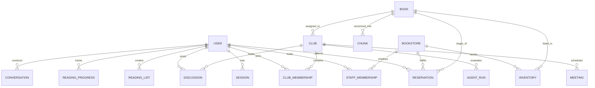
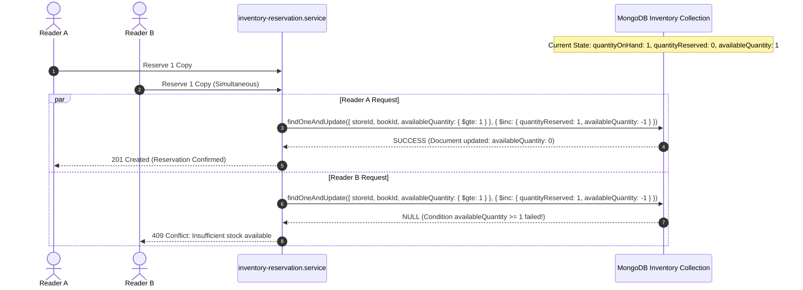
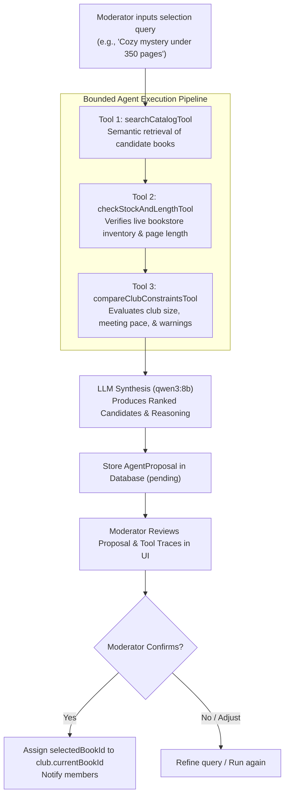

# Architecture & Technical Design Specification

## 1. Domain Entities & Database Schema

The application is modeled around independent bookstores, community clubs, and reader journeys with strict data normalization and auditability.



### Key Models & Schemas:
- **`Book`**: Stores metadata (`title`, `authors`, `genres`, `themes`, `moods`, `readingLength`, `embedding` vector array 768/1536 dims).
- **`Inventory`**: Stores `quantityOnHand`, `quantityReserved`, and `availableQuantity`. Uses compound index `{ storeId: 1, bookId: 1 }` with uniqueness.
- **`Reservation`**: Tracks hold state (`pending`, `confirmed`, `collected`, `cancelled`, `expired`), hold expiration timestamp, and store pickup window.
- **`ReadingProgress`**: Tracks user's reading position (`currentChapter`, `currentPage`, `spoilerMode`, `status`).
- **`Discussion`**: Stores club posts with `hasSpoilers`, `spoilerChapter`, and `isSpoilerForViewer` evaluated dynamically upon fetch.
- **`AgentRun`**: Records bounded 3-tool executions with tool inputs, tool outputs, ranked candidate proposals, and moderator confirmation status.
- **`AuditLog`**: Append-only log of sensitive operations (inventory adjustments, status overrides, role grants).

---

## 2. Spoiler-Aware RAG Pipeline

```mermaid
sequenceDiagram
    autonumber
    actor Reader
    participant Controller as book-chat.controller
    participant ProgressService as reading-progress.service
    participant RAG as spoiler-aware-rag.service
    participant VectorStore as MongoDB Chunks
    participant Ollama as Ollama qwen3:8b

    Reader->>Controller: POST /api/book-chat { bookId, message }
    Controller->>ProgressService: Get reader's current chapter & spoilerMode
    ProgressService-->>Controller: currentChapter = 4, spoilerMode = "progress_limited"
    Controller->>RAG: queryBookGrounded(bookId, message, { maxPermittedChapter: 4 })
    RAG->>VectorStore: Query embeddings WHERE bookId = bookId AND chapterNumber <= 4
    VectorStore-->>RAG: Filtered chapter chunks (1..4)
    RAG->>Ollama: Generate grounded answer with strict boundary & citation instructions
    Ollama-->>RAG: Grounded response + citations
    RAG->>RAG: Scan response against future plot knowledge; apply mask if necessary
    RAG-->>Controller: { reply, citations, maskedContent }
    Controller-->>Reader: JSON Response
```

---

## 3. Concurrency-Safe Atomic Reservation Flow

To prevent race conditions and overselling when multiple readers attempt to reserve the last available physical copy:



---

## 4. Bounded 3-Tool AI Agent Architecture


